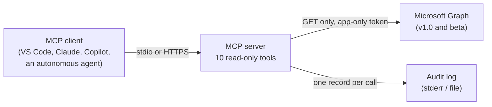

# Entra Agent Inventory MCP server

A read-only [Model Context Protocol](https://modelcontextprotocol.io/) server that tells you
which identities in a Microsoft Entra tenant are AI agents, how exposed they are, who answers
for them, and what moving them to Microsoft Entra Agent ID involves.

It is built for the period when agents live in two places at once: as native Entra agent
identities, and as ordinary service principals and app registrations created by earlier
versions of Copilot Studio, Azure AI Foundry or custom code. Microsoft's migration guidance
describes how to find the second kind: inventory the service principals, look at their
permissions, sign-in patterns, tags and names, and weight those signals into a confidence
score. This server does that for the identities you name, on demand, and returns the
evidence behind every result.

- **10 tools, all read-only.** GET requests to Microsoft Graph only; no tool can change the
  tenant.
- **Live.** Every answer is read from Graph when you ask. There is no cache and no
  tenant-wide sweep.
- **Explainable.** Each identity gets a likelihood score with the signals that fired and why,
  a priority, the exposures behind it, and a contact.
- **Safe to hand to an agent.** Fixed tools with validated inputs and limits set in code,
  app-only Graph access, app roles for callers over HTTP, and an audit record for every call.

Confidence markers used in this README: **[ML]** verified on Microsoft Learn, **[A]** a design
choice of this project, **[U]** unverified, confirm in your tenant.

> **Status.** Tested against simulated Graph responses and one lab tenant. Sign-in summaries
> come from Microsoft Graph **beta** endpoints, which Microsoft does not support for
> production use. [ML] Run `check_access` first.

## How it works



The server signs in to Graph as an app registration or managed identity, through Azure
Identity's `DefaultAzureCredential`. Callers reach it over stdio (a local process started by
your MCP client) or over streamable HTTP, where it requires an API key or an Entra token.

## Tools

Every tool except `check_access` and `list_ownerless_agents` takes **object IDs**. There is no
search by name; find the object ID in the Entra admin center first (see "Which ID" below).

| Tool | What it answers | Limits |
|---|---|---|
| `check_access` | Which Graph permissions the server has, and which tools each missing one affects. Run it first. | None |
| `classify_principal` | What one object is, its agent likelihood with evidence, priority, exposures, contact and migration wave. | 1 identity. Sign-in window 1-30 days (default 30). Top 8 resources returned. |
| `assess_principals` | The same assessment for several identities, one row each. | **Up to 25 identities per call** (`assess_max_principals`); duplicates removed. 30-day window. 5 Graph calls in parallel. |
| `list_ownerless_agents` | Native Entra agent identities with no owners, newest first, each with its sponsors. **Tenant-wide: needs the tenant-wide app role over HTTP.** | 1-500 returned (default 100); `total_matches` gives the full count. Checks up to 5,000 identities itself if Graph refuses the filter (`agent_list_scan_limit`). |
| `get_agent_signins` | Sign-in summary for one principal, including Conditional Access results. | 1 identity. Window 1-30 days (default 7). Reads up to 5,000 events (`MAX_SIGNIN_EVENTS`); returns a summary and 20 sample events. |
| `get_credential_inventory` | Secrets, certificates and federated credentials with expiry, and the migration wave they imply. | 1 identity |
| `get_access_footprint` | Application permissions, delegated grants, directory roles, owners, sponsors and migration blockers. | 1 identity. Up to 1,000 app-role assignments and 500 inbound consumers. |
| `get_conditional_access_coverage` | Which Conditional Access policies enforce, only report on, or exclude the identity, and why some can't cover it. | 1 identity. Up to 1,000 policies. |
| `get_principal_changes` | Directory changes to the principal and its app registration, by severity. | 1 identity. Window 1-30 days (default 30). Up to 200 events, and it says when it cut the list. |
| `compare_coexistence` | A legacy identity and the agent identity replacing it, side by side: parity, failures, Conditional Access results, cutover signal. | 2 identities. Window 1-30 days (default 14). Up to 5,000 sign-in events each. |

**Prompts.** `migration_readiness(object_id)` runs the pre-migration review of one identity;
`coexistence_review(legacy_object_id, new_object_id)` runs the cutover check. Your MCP client
offers them as slash commands. They return instructions that name the tools to call; the
model then calls them.

### Inputs

| Tool | Input | Required | Accepted values | If it's wrong |
|---|---|---|---|---|
| `check_access` | none | | | |
| `list_ownerless_agents` | `max_results` | no | 1-500, default 100 | Clamped into range |
| `classify_principal` | `object_id` | **yes** | Service principal, agent identity, managed identity or user | Rejected before any Graph call if not a GUID |
| | `activity_days` | no | 1-30, default 30 | Clamped into range |
| `assess_principals` | `object_ids` | **yes** | List of 1-25 object IDs | Whole call rejected if any ID isn't a GUID or there are more than 25 |
| `get_agent_signins` | `object_id` | **yes** | As for `classify_principal` | As above |
| | `days` | no | 1-30, default 7 | Clamped into range |
| | `include_samples` | no | `true` or `false`, default `true` | |
| `get_credential_inventory` | `object_id` | **yes** | Service principal, agent identity or managed identity | Users are rejected |
| `get_access_footprint` | `object_id` | **yes** | As above | Users are rejected |
| `get_conditional_access_coverage` | `object_id` | **yes** | Service principal, agent identity or managed identity | Rejected before any Graph call if not a GUID |
| `get_principal_changes` | `object_id` | **yes** | Any object ID, users included | Rejected before any Graph call if not a GUID |
| | `days` | no | 1-30, default 30 | Clamped into range |
| | `min_severity` | no | `info`, `low`, `medium`, `high`; default `low` | Rejected before any Graph call |
| `compare_coexistence` | `legacy_object_id` | **yes** | The old service principal or managed identity | Rejected before any Graph call if not a GUID |
| | `new_object_id` | **yes** | The agent identity replacing it | As above |
| | `days` | no | 1-30, default 14 | Clamped into range |

**Which ID.** Use the **service principal's object ID**: under Enterprise applications in the
Entra admin center, or "Object (principal) ID" on an Azure resource's Identity page for a
managed identity. The application (client) ID and the app registration's object ID are
different values and return "Object not found in this tenant".

### What it can't do

- Scan the whole tenant, or search by name. Every assessment starts from an object ID.
- Change anything: no disable, grant, revoke or delete.
- See further back than 30 days. That is the Entra sign-in and audit log retention for
  P1 and P2 tenants. [ML]
- Score users. `classify_principal` only shows whether a user account acts as an agent user.

## Scoring

Microsoft first-party apps (recognised by their Microsoft owner tenant) are reported as
`microsoft_managed` and not scored. Native agent identities are always scored, even when a
Microsoft-owned blueprint such as Copilot Studio's created them: they are your agents.

**Agent likelihood, 0 to 21** [A]. Ten signals, each worth 1 to 3 points. The score is the
sum of the signals that fire, with no cap. The top of the scale is the sum of the weights,
so it changes if you change the weights; every answer reports it as `likelihood_max`.

| Signal | Weight | Fires when |
|---|---|---|
| `created_by_agent_platform` | 3 | `createdByAppId` is in `agent_creator_app_ids` (Copilot Studio, Foundry) |
| `connects_to_mcp` | 3 | Sign-ins to an app in `mcp_server_app_ids` or `mcp_server_resource_names` |
| `ai_resource_access` | 3 | Sign-ins to a resource matching `ai_resource_hints` |
| `uses_ai_gateway` | 3 | Sign-ins to an AI gateway in `ai_gateway_app_ids` or `ai_gateway_resource_names`. Behind a gateway such as Azure API Management, model calls are made by the gateway's identity, so this restores the evidence. |
| `agent_like_name` | 2 | Display name matches `agent_name_pattern` |
| `agent_marker` | 2 | An agent-like tag, or the custom security attribute in `agent_security_attribute` |
| `bot_framework_redirect` | 2 | A redirect URI on the Bot Framework token service (`bot_framework_redirect_hosts`) |
| `high_volume` | 1 | 50 or more sign-ins on one day |
| `multi_resource` | 1 | 3 or more resources on one day |
| `federated_credential` | 1 | Has a federated identity credential |

**Agent status.**

| Status | Rule |
|---|---|
| `confirmed` | A native Entra agent identity, blueprint principal or agent user; or a legacy service principal carrying a tag in `confirmed_agent_tags` (default: Copilot Studio's own `AgentCreatedBy:CopilotStudio` and `power-virtual-agents-*` [ML]), whatever its score |
| `likely` | Likelihood at or above `likely_threshold` (default 6) |
| `unlikely` | Scored, below the threshold |
| `not_scored` | Microsoft first-party app |

**Exposures** add no points; they set the priority. High: `mail_send`, `broad_files_write`,
`no_contact`, `privileged_role`, `other_high_risk`. Medium: `calendar_teams`,
`credential_expiring`.

**Priority.**

| Priority | Rule |
|---|---|
| `urgent` | A confirmed or likely agent with at least one high exposure |
| `governance_gap` | A confirmed agent whose only contact is its creator or nobody, or that no Conditional Access policy covers |
| `review` | Any other confirmed or likely agent, and any identity below the threshold with an agent-like name |
| `ok` | Not an agent by these signals |
| `microsoft_managed` | Microsoft first-party: not scored |

**Contact**, for following up: the service principal's first user owner, then the app
registration's owner, then the sponsor (agent identities and blueprint principals), then
whoever created it. The audit log keeps the creator for 30 days only, so older identities
without owners show none.

**Migration wave** [A] comes from the credential type: client secrets first, then
certificates, then federated credentials, then managed identities; blueprint-managed
identities are already migrated.

The weights are a starting point, not a calibrated model. Review results with the identity
owners and tune them in `config.json`.

## Requirements

- Python 3.10 or later (the container image uses 3.12).
- A Microsoft Entra tenant with **Entra ID P1 or P2**: reading sign-in data through Graph
  needs it, and sign-ins and audit events are kept for 30 days (7 days on the free tier). [ML]
- An app registration (local use) or a managed identity (Azure) with the Graph
  **application** permissions below, and admin consent.

| Permission | Level | Used for |
|---|---|---|
| `Application.Read.All` [ML] | Required | Principals, app registrations, credentials, federated credentials, app roles, owners |
| `AuditLog.Read.All` [ML] | Required | Sign-ins and sign-in summaries (**beta**), directory audits, creators |
| `AgentIdentity.Read.All` [ML] | Required | Listing agent identities |
| `Policy.Read.All` [ML] | Recommended | Conditional Access policies and coverage |
| `RoleManagement.Read.Directory` [ML] | Recommended | Directory roles and the privileged-role exposure |
| `User.Read.All` | Recommended | Classifying user objects |
| `Directory.Read.All` [ML] | Optional, broad | Delegated permission grants only |
| `GroupMember.Read.All` [U] | Optional | Detecting Conditional Access policies assigned through groups |

A missing permission doesn't fail a tool: the affected section comes back as
`not_permitted`, which is a gap in the answer, not a finding. `az login` tokens usually lack
`AuditLog.Read.All`, so use an app registration.

## Quick start

```bash
git clone <this repository> && cd entra-agent-inventory-mcp
python3 -m venv .venv
source .venv/bin/activate              # Windows: .venv\Scripts\activate
pip install -r requirements.txt
cp .env.example .env                   # then fill in your tenant and app registration
python -m entra_agent_inventory --check
```

`--check` prints which permissions are granted and exits with code 1 if a required one is
missing. Start the server with `python -m entra_agent_inventory`. In stdio mode it then waits
for an MCP client on standard input, so a terminal looks idle; that is expected.

**Run it from the repository root.** The package is not installed with `pip install`, and
`.env` is read from the current folder. On Windows PowerShell, call the virtual
environment's Python explicitly: `.\.venv\Scripts\python.exe -m entra_agent_inventory`.

### Connect an MCP client

- **VS Code (GitHub Copilot agent mode or any MCP client):** `.vscode/mcp.json` is included.
  Start the server from the MCP view. On Windows, change the command to
  `${workspaceFolder}/.venv/Scripts/python.exe`.
- **Claude Code:** `.mcp.json` is included; approve the project server when asked.
- **Other clients** (Claude Desktop, Visual Studio and others): add a stdio server that runs
  the virtual environment's Python with `-m entra_agent_inventory`, in the repository folder:

```json
{
  "mcpServers": {
    "entra-agent-inventory": {
      "command": "/path/to/entra-agent-inventory-mcp/.venv/bin/python",
      "args": ["-m", "entra_agent_inventory"],
      "cwd": "/path/to/entra-agent-inventory-mcp",
      "env": { "ENV_FILE": "/path/to/entra-agent-inventory-mcp/.env" }
    }
  }
}
```

Then ask in plain language, for example: "Check which Graph permissions the inventory server
has", "Is `<object ID>` an agent, and who owns it?", "Which agent identities have no owner?",
or "Is `<legacy ID>` ready to cut over to `<new ID>`?".

### Try it over HTTP locally

```bash
MCP_TRANSPORT=streamable-http MCP_API_KEY=demo-key python -m entra_agent_inventory
```

PowerShell: `$env:MCP_TRANSPORT="streamable-http"; $env:MCP_API_KEY="demo-key"` and then
`.\.venv\Scripts\python.exe -m entra_agent_inventory`.

It listens on `http://127.0.0.1:8000/mcp` and expects `Authorization: Bearer demo-key`. The
MCP Inspector (`npx @modelcontextprotocol/inspector`) can connect to it. The API key mode is
for local testing; use Entra authentication when you host it.

## Configuration

There are three kinds of setting. None of them is typed into a tool call.

**1. Graph access**, read by `DefaultAzureCredential`:

| Variable | Local (app registration) | Azure (managed identity) |
|---|---|---|
| `AZURE_TENANT_ID` | Your tenant ID | Not needed |
| `AZURE_CLIENT_ID` | The app registration's client ID | The user-assigned identity's client ID; omit for a system-assigned identity |
| `AZURE_CLIENT_CERTIFICATE_PATH` or `AZURE_CLIENT_SECRET` | A certificate (preferred) or a secret | Not needed |

**2. Server behaviour**, as environment variables or in `.env` (real environment variables
win; `ENV_FILE` points to another file, `ENV_FILE=""` turns loading off):

| Variable | Default | Purpose |
|---|---|---|
| `CONFIG_FILE` | not set | Path to your `config.json` (scoring and tuning) |
| `MCP_TRANSPORT` | `stdio` | `streamable-http` to serve over HTTP |
| `MCP_HOST`, `MCP_PORT` | `127.0.0.1`, `8000` | HTTP listener |
| `MAX_SIGNIN_EVENTS` | `5000` | Event ceiling for `get_agent_signins` and `compare_coexistence` |
| `GRAPH_CONCURRENCY` | `5` | Parallel Graph calls in `assess_principals` |
| `AUDIT_LOG_FILE` | not set | Also write the audit trail to this file |
| `MCP_AUTH_MODE` and the other `MCP_*` variables | | Who may call the server over HTTP; see "Hosting" |

**3. Scoring and tuning:** copy `config/config.example.json` to `config/config.json`, edit it
and set `CONFIG_FILE=config/config.json`. Every key is optional and unknown keys are
rejected. Before relying on the scores, set:

- `agent_creator_app_ids`: the app IDs that create agent service principals in your tenant
  (read `createdByAppId` on a known Copilot Studio or Foundry agent).
- `mcp_server_app_ids` / `mcp_server_resource_names`: your MCP servers registered in Entra.
- `ai_gateway_app_ids` / `ai_gateway_resource_names`: your AI gateway, if agents get Entra
  tokens for it. It only works if the gateway validates Entra tokens.
- `ai_resource_hints`: run `get_agent_signins` on a known Azure OpenAI caller and match the
  resource names it shows.

Until the first three are set, `created_by_agent_platform`, `connects_to_mcp` and
`uses_ai_gateway` can't fire.

## Hosting

`Dockerfile` builds a non-root image that serves streamable HTTP on port 8000, with `/health`
(public) and `/mcp`. **The server refuses to listen on a non-loopback address without
authentication.** For Entra authentication, for example in Azure Container Apps:

| Variable | Value |
|---|---|
| `MCP_AUTH_MODE` | `entra` |
| `MCP_AUTH_TENANT_ID` | The tenant whose tokens callers present |
| `MCP_AUTH_AUDIENCE` | `api://<server-app-id>,<server-app-id>` |
| `MCP_RESOURCE_URL` | Public URL of the MCP endpoint |
| `MCP_REQUIRED_ROLE` | App role every caller needs, for example `Inventory.Read` |
| `MCP_TENANT_WIDE_ROLE` | App role for tenant-wide lists (`list_ownerless_agents`), for example `Inventory.TenantWide` |
| `MCP_ALLOWED_HOSTS` | The host name clients use |

Give the hosting identity (a managed identity in Azure) the Graph permissions above. Give
autonomous agents `Inventory.Read` only unless they need the tenant-wide list. App roles are
checked only with `MCP_AUTH_MODE=entra`. Over stdio, or with the API key, whoever starts or
reaches the server has every tool.

## Security model

- **Read-only.** The Graph client sends GET requests only; `$batch` carries GETs only.
- **Validated before Graph.** Object IDs must be GUIDs and choices come from fixed lists, so
  bad input never produces a Graph call. No tool takes a free-form path, URL or filter.
- **Limits in code.** Per-call limits are enforced by the server, not by the model, so a chat
  agent can't raise them.
- **Gated.** Over HTTP every caller needs `MCP_REQUIRED_ROLE`; the tenant-wide list also needs
  `MCP_TENANT_WIDE_ROLE`.
- **Audited.** One JSON record per tool call on stderr, and optionally in `AUDIT_LOG_FILE`:
  the caller from the validated token, the arguments with secrets redacted, the outcome, the
  duration and the Graph request ID on failure. Results are never logged.
- **Personal data.** Answers name people (owners, sponsors, creators). Treat output from a
  real tenant accordingly.

## Repository layout

| Path | What |
|---|---|
| `entra_agent_inventory/server.py` | Server assembly, transports, HTTP safety checks |
| `entra_agent_inventory/tools.py` | The tools, the `check_access` probes |
| `entra_agent_inventory/assess.py` | `assess_principals` |
| `entra_agent_inventory/prompts.py` | The two prompts |
| `entra_agent_inventory/scoring.py` | Signals, likelihood, status, priority, contact |
| `entra_agent_inventory/facts.py` | Collects the facts scoring needs for one identity |
| `entra_agent_inventory/collectors.py` | The Graph queries |
| `entra_agent_inventory/graph.py` | GET-only Graph client with paging, retries and `$batch` |
| `entra_agent_inventory/analysis.py` | Credentials, migration waves, Conditional Access and sign-in analysis |
| `entra_agent_inventory/auth.py`, `audit.py`, `validation.py`, `config.py` | Caller authentication, audit trail, input checks, settings |
| `config/config.example.json` | Every tuning key with its default |
| `.env.example` | Environment variables to copy into `.env` |
| `.vscode/mcp.json`, `.mcp.json` | MCP client entries for VS Code and Claude Code |
| `Dockerfile` | Container image for HTTP hosting |

Both MCP Python SDK 1.x (`FastMCP`) and 2.x (`MCPServer`) are supported.

## No warranty/limitation of liability
This software is provided "as is" without warranties or conditions of any kind, either express or implied. I am (Mustafa Hassan) not liable for any damages that result from use, misuse, or misconfiguration of this software.

## Authorship

Designed and directed by Mustafa Hassan; implemented with AI coding assistants under his review.

## Licence

Copyright 2026 Mustafa Hassan. Licensed under the Apache License 2.0; see [LICENSE](LICENSE).
Redistributions must keep the attribution in [NOTICE](NOTICE). This project is not
affiliated with or endorsed by Microsoft.
